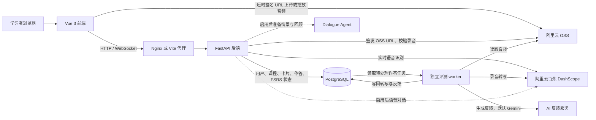

# LanGear

LanGear 是一个 AI 辅助的英语复述与间隔复习应用。学习者在课程或牌组中听参考音频、录音复述，查看转写与反馈，再按掌握程度评分；系统用 FSRS 安排下一次复习。仓库也包含课后情景对话功能，其服务按配置启用。

## 系统架构



前端只接触业务 API 与后端签发的短时 OSS URL。用户数据、卡片内容、作答记录、任务状态和复习计划在 PostgreSQL 中；音频文件在 OSS 中，数据库保存其元数据和归属关系。AI 服务密钥保留在服务端。

### 技术组成

| 层次 | 实现 | 作用 |
| --- | --- | --- |
| 前端 | Vue 3、TypeScript、Vite、Pinia、Vue Router、Element Plus | 学习、录音、反馈展示、课程与卡片管理 |
| API | FastAPI、SQLAlchemy、Alembic | 登录鉴权、内容管理、复习队列、音频授权、对话会话 |
| 数据库 | PostgreSQL | 持久化用户、课程、卡片、作答、异步任务和 FSRS 状态 |
| 对象存储 | 阿里云 OSS | 保存用户录音和参考音频，通过签名 URL 访问 |
| 语音识别 | 阿里云百炼 DashScope，`qwen3-asr-flash` | 异步录音转写；另有实时 ASR WebSocket 链路 |
| AI 反馈 | 默认 Gemini 官方 `google-genai` SDK；可配置 Qwen Omni | 根据作答与参考内容生成反馈 |
| 复习调度 | `py-fsrs` | 根据学习者评分计算下次复习时间 |
| 可选对话 | `dialogue-agent/` Node 服务与实时语音模型 | 完成一轮练习后的情景对话；与卡片复习记录分开 |

### 一次录音复述如何流转

1. 前端从 API 获取课程、卡片与复习队列，播放参考音频并在浏览器录音。实时转写启用时，音频片段通过后端 WebSocket 转发给 DashScope。
2. 前端向 API 申请录音上传授权。后端创建音频元数据并返回约 15 分钟有效的 OSS 签名上传 URL；浏览器直传 OSS，再由后端核对文件大小、类型和格式。
3. 前端提交本次作答。后端保存作答快照，并在 PostgreSQL 中写入待处理任务。独立 worker 从数据库领取任务，调用 DashScope 转写与配置的 AI 反馈服务，把结果写回作答记录。已有实时转写时无需重复发起离线 ASR。
4. 前端轮询作答状态，显示转写与反馈。学习者选择 `again`、`hard`、`good` 或 `easy` 后，后端用 FSRS 更新卡片计划。评分与 AI 反馈处理相互独立，无需等待反馈完成。

## 仓库结构

```text
frontend/         Vue 应用、组件与前端测试
backend/core/     当前 FastAPI API、业务逻辑、存储与模型适配器
backend/core_migrations/  PostgreSQL Alembic 迁移
backend/core_tests/       后端测试
dialogue-agent/   可选的独立情景对话规划服务
scripts/release/  前后端同版本构建、验收与发布工具
docs/             设计、计划与运维说明
```

后端 API 入口是 `core.main:app`；当前发布镜像使用 `core.core_only:app`，额外提供过渡期的 `/api/content/v1` 别名。独立评测 worker 的入口是 `python -m core.processing`。

## 开发与运行

### 本地前端连接 staging

日常前端开发使用已配置的 staging API，不需要在本机启动后端：

```bash
cd frontend
pnpm install --frozen-lockfile
pnpm dev
```

打开 `http://localhost:3002`。Vite 把 `/api` 代理到 `VITE_DEV_PROXY_TARGET`，默认是 staging 公网预览地址；`VITE_API_BASE_URL` 决定实际 API 路径。当前前端示例环境使用 `/api/content/v1` 过渡别名，核心 API 原生路径是 `/api/v1`。调整代理或排查环境时先检查 `frontend/.env`、`frontend/.env.development.local` 和 [vite.config.ts](frontend/vite.config.ts)。具体路由见 [开发与生产环境](docs/operations/dev-prod-workflow.md)。

### 本地基础服务

仓库根目录的 `docker-compose.yml` 提供 PostgreSQL、数据库迁移、后端和 Nginx 前端。先根据 [后端配置示例](backend/.env.example) 建立 `backend/.env`，配置数据库、会话密钥以及需要使用的 OSS、ASR、AI 服务，再运行：

```bash
docker compose up --build -d
# 另开终端运行评测 worker；根目录 Compose 尚未定义常驻 worker 服务
docker compose run --rm --no-deps backend python -m core.processing
```

前端地址为 `http://localhost:8080`，API 健康检查为 `http://localhost:8000/health`。本地 Compose 的 Nginx 实时 ASR WebSocket 专用规则仍使用旧路径；完整录音与实时识别联调以 staging 环境为准。服务端配置只从 `backend/.env` 或运行环境读取，不使用仓库根目录 `.env`。

### 验证

```bash
cd frontend
pnpm test
pnpm typecheck
pnpm build
```

后端测试必须使用一次性、独立的 PostgreSQL 测试库。设置指向 `lan30_test_*` 数据库的 `CORE_TEST_DATABASE_URL` 后，在 `backend/` 执行 `uv run pytest core_tests`；不要指向 staging 或生产库。前端端到端测试入口为 `cd frontend && pnpm test:e2e`。

## 部署与文档

发布流程从同一个 Git SHA 构建前后端产物；staging 验收和生产发布由 `scripts/release/manage.py` 管理。运行中的版本以发布记录和镜像 ID 为准，不能只看服务器源码 checkout。详见 [开发与生产环境](docs/operations/dev-prod-workflow.md) 与 [Agent 工作规则](AGENTS.md)。

本 README 说明当前仓库代码架构。功能是否已在某个环境启用，取决于该环境部署的镜像、数据库迁移和服务端配置；情景对话尤其需要单独启用并部署 `dialogue-agent/`。
